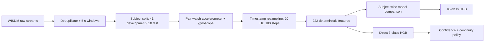

# Wearable Activity Recognition

An end-to-end human-activity-recognition investigation using smartwatch
accelerometer and gyroscope signals. The project moves from raw WISDM sensor
streams through subject-independent evaluation, timestamp-aware resampling,
engineered features, classical and neural model comparisons, and a separate
three-class wellness use case.

The strongest 18-class model is a histogram gradient boosting classifier over
222 deterministic time-, distribution-, correlation-, and frequency-domain
features. On ten held-out subjects it reached **0.6851 macro-F1**. A separate
business experiment groups the activities into physical activity, food or
drink, and other daily activity; its frozen policy reached **0.8603 macro-F1**
and **0.8981 food-or-drink precision** on the same reserved subjects.

## Why subject-wise evaluation matters

Sensor windows from one person are highly related. A random row split would put
the same wearer's motion patterns in training and validation and produce an
overly optimistic result. This project therefore freezes:

- 41 development subjects and 10 reserved test subjects;
- five development folds separated by subject;
- non-overlapping five-second windows; and
- one final test evaluation after model and policy selection.

The 18-class and three-class tasks are reported separately. The ten test
subjects were used first for the completed 18-class evaluation and later for a
new grouped target. They were not used to develop the grouped classifier or
policy, but they are not globally unseen by the repository.

## Pipeline



The signals are paired only when both watch sensors have a valid matching
window. Each sensor is interpolated on its own timestamp axis; missing partners
are not synthesized. Population-learned transformations are fitted inside the
appropriate training fold.

## Main results

### 18-class model selection

All development comparisons use the same 25,585 paired windows and five
subject-wise folds.

| Experiment | Mean development macro-F1 | Interpretation |
| --- | ---: | --- |
| Phone accelerometer RF baseline | 0.301 | A single phone stream is insufficient |
| Paired watch accel + gyro RF | 0.6907 | Sensor fusion is a large improvement |
| Resampled 20 Hz parity RF | 0.6882 | Resampling preserves the classical baseline |
| RF with 222 engineered features | 0.7257 | Frequency and temporal features help |
| Dual-branch 1D CNN | 0.6762 | Stable, but below the engineered RF |
| Logistic regression | 0.7126 | Much of the feature space is linearly separable |
| Feature MLP | 0.7341 | Competitive but below boosting |
| **Histogram gradient boosting** | **0.7446** | Selected final model; won all five folds vs RF |

The frozen HGB model was fitted on all 41 development subjects and evaluated
once on 6,161 windows from ten reserved subjects:

| Metric | Held-out result |
| --- | ---: |
| Accuracy | 0.6780 |
| Balanced accuracy | 0.6773 |
| Macro-F1 | **0.6851** |

Generalization is uneven: subject macro-F1 ranges from 0.2059 to 0.8706.
Jogging reaches 0.973 F1, while Eating Sandwich reaches 0.175. These failures
are preserved rather than hidden behind the aggregate score.

### Grouped wellness use case

The separate three-class target maps activities to:

- `physical_activity`;
- `food_or_drink`; and
- `other_daily_activity`.

A direct three-class HGB model slightly outperformed aggregating probabilities
from an 18-class model and improved development food precision. The frozen
window policy then accepts food predictions only at probability at least 0.75
and requires four consecutive accepted windows (20 seconds).

| Held-out metric | Raw classifier | Frozen policy |
| --- | ---: | ---: |
| Macro-F1 | 0.8708 | 0.8603 |
| Food precision | 0.8671 | **0.8981** |
| Food recall | 0.7761 | 0.7090 |
| Physical recall | 0.9129 | 0.9133 |

The policy makes the intended precision-recall trade-off. On controlled
single-activity recordings it detected 41 of 49 food recordings and alerted on
5 of 127 non-food recordings. These are controlled-recording diagnostics—not
claims about notification rates in everyday life.

## Dataset

This project uses the **WISDM Smartphone and Smartwatch Activity and Biometrics
Dataset**: 51 subjects performing 18 activities with phone and watch
accelerometer and gyroscope recordings.

Download it from the [UCI Machine Learning Repository](https://archive.ics.uci.edu/dataset/507/wisdm+smartphone+and+smartwatch+activity+and+biometrics+dataset)
and cite:

> Weiss, G. (2019). WISDM Smartphone and Smartwatch Activity and Biometrics
> Dataset. UCI Machine Learning Repository. DOI: 10.24432/C5HK59.

The dataset is distributed by UCI under CC BY 4.0. Raw data is not redistributed
in this repository.

After extracting `wisdm-dataset.zip`, arrange the raw files as:

```text
raw/
├── phone/
│   ├── accel/data_1600_accel_phone.txt ... data_1650_accel_phone.txt
│   └── gyro/data_1600_gyro_phone.txt   ... data_1650_gyro_phone.txt
└── watch/
    ├── accel/data_1600_accel_watch.txt ... data_1650_accel_watch.txt
    └── gyro/data_1600_gyro_watch.txt   ... data_1650_gyro_watch.txt
```

There should be 51 files in each of the four leaf directories. The archive's
own `raw/phone` and `raw/watch` directories can be copied directly into the
repository's ignored `raw/` directory.

## Setup

The recorded environment used Python 3.12.1.

```bash
git clone https://github.com/YairLutaty/wearable-activity-recognition.git
cd wearable-activity-recognition

python3.12 -m venv .venv
source .venv/bin/activate
python -m pip install --upgrade pip
python -m pip install -r requirements.txt
python -m ipykernel install --user --name wearable-activity-recognition
```

Install the neural-model dependency only if running the CNN or MLP notebooks:

```bash
python -m pip install -r requirements-neural.txt
```

No credentials or environment variables are required.

## Quick verification without the dataset

The lightweight tests validate the subject split, fold coverage, preprocessing
and final-result contracts, grouped-task disclosure, and the 222-feature
extractor on synthetic signals:

```bash
python -m unittest discover -s tests -v
```

They do not retrain models or download data.

## Full execution order

The notebooks retain their saved outputs, so results can be inspected on GitHub
without downloading the dataset. Full regeneration requires the raw data and
several large ignored intermediate artifacts.

1. Optional EDA: open `eda/eda.ipynb` from the repository root.
2. Build canonical windows:

   ```bash
   python baseline/shared_train_test_samples.py
   ```

3. Open `baseline/baseline.ipynb` with the notebook working directory set to
   `baseline/`.
4. Freeze the train/test Parquet files:

   ```bash
   python modified/build_windowed_splits.py
   ```

5. Run `preprocessing/preprocessing.ipynb` to build paired 20 Hz sequences.
6. Run the development notebooks in order:

   ```text
   modeling/01_rf_parity.ipynb
   modeling/02_engineered_rf.ipynb
   modeling/03_cnn.ipynb                  # requires PyTorch
   modeling/04_tabular_models.ipynb
   modeling/05_feature_mlp.ipynb          # requires PyTorch
   ```

7. `modeling/06_final_evaluation.ipynb` reproduces the closed 18-class test.
8. Run the separate grouped task in order:

   ```text
   business_case/01_grouped_target.ipynb
   business_case/02_business_policy.ipynb
   business_case/03_test_evaluation.ipynb
   ```

The final-evaluation notebooks should not be used for further model selection.
A new improvement cycle requires a new independent test population.

## Repository map

- `eda/eda.ipynb` — data quality, timing, synchronization, and subject analysis
- `baseline/` — canonical window builder and classical baselines
- `preprocessing/preprocessing.ipynb` — pairing and timestamp-based resampling
- `modeling/engineered_features.py` — reusable 222-feature extractor
- `modeling/01_...05_*.ipynb` — controlled development experiments
- `modeling/06_final_evaluation.ipynb` — closed 18-class test evaluation
- `business_case/` — separate grouped target and event-policy investigation
- `*/artifacts/*.json` — small tracked protocols and result records
- `docs/experiment-report.md` — detailed EDA, experiment, and failure analysis
- `tests/` — data-free contract and feature-extraction checks

Large Parquet/NPZ datasets, fitted models, predictions, virtual environments,
and caches are ignored. Small JSON contracts and executed notebooks are kept so
the numerical claims can be audited.

## Limitations

- The source data comes from controlled three-minute activity recordings, not
  unconstrained daily life.
- The test population contains only ten people, and performance varies sharply
  by subject.
- The final 18-class model struggles with similar eating activities.
- Resampling uses interpolation and edge padding without an anti-alias filter.
- The grouped food policy is not a meal detector and has no cooldown, daily
  alert limit, online latency measurement, or battery evaluation.
- No model artifact is distributed; full reconstruction requires the external
  raw dataset and notebook pipeline.
- The grouped task reused subjects previously evaluated for the separate
  18-class task, as disclosed above.

This repository does not claim medical, nutritional, caloric, or production
deployment validity.
